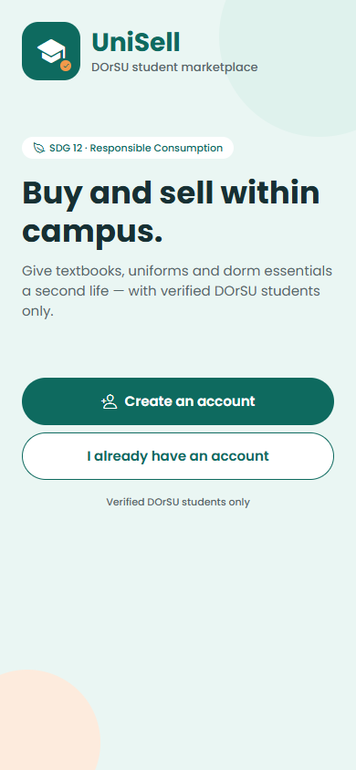
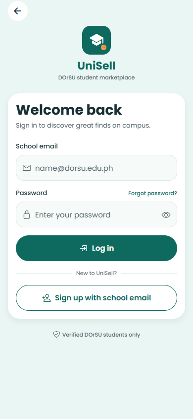
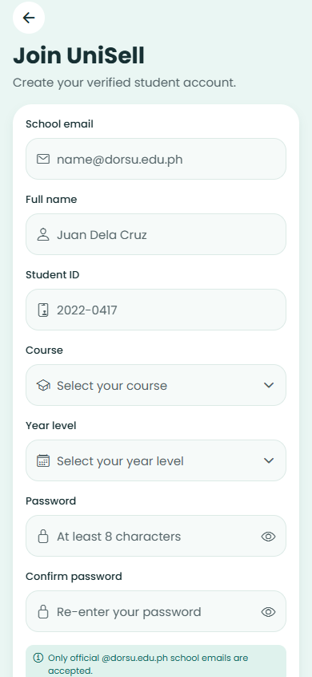
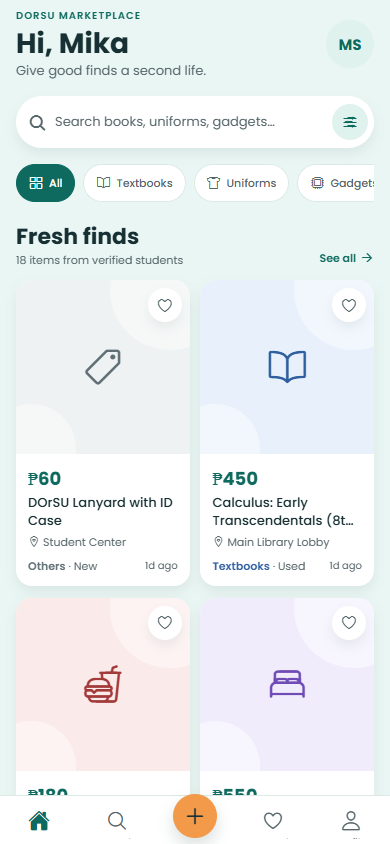
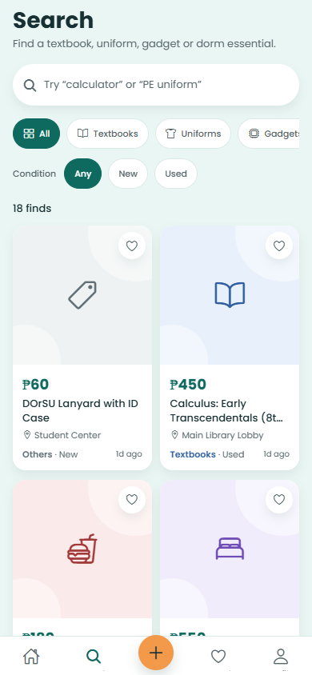
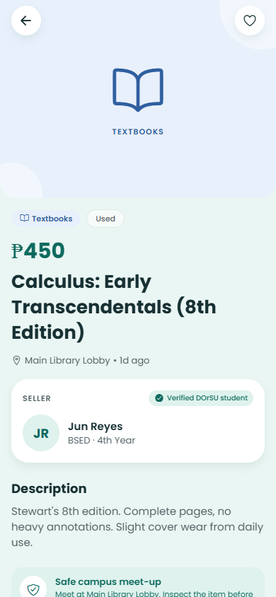
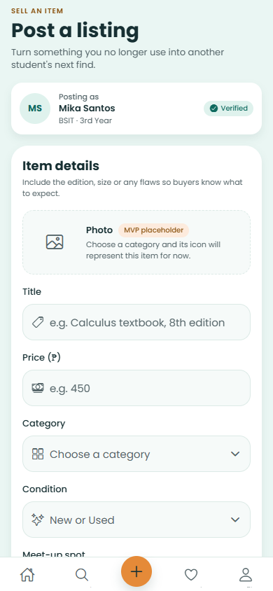
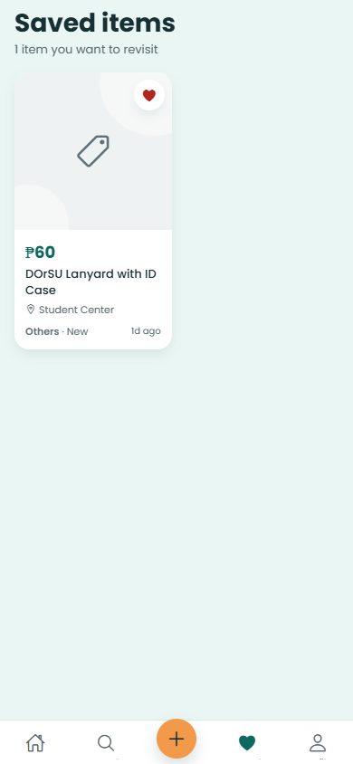
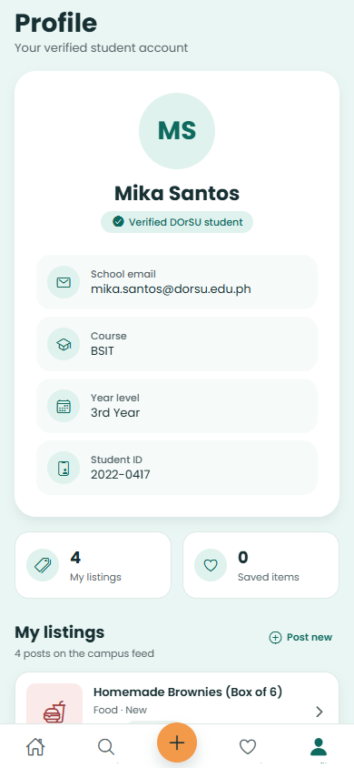

# UniSell

**A verified student marketplace for Davao Oriental State University (DOrSU).**
Buy, sell, and give campus essentials a second life — built for the ITMSD1 Inter-Class Mobile Hackathon under **SDG 12: Responsible Consumption and Production**.

> Current status: **Figma-alignment Phases 0–3 are implemented.** The app now matches the Figma Make reference across Welcome, auth, Home, Search, Listing Details, Post, Saved, Profile/Seller shop, Settings, Design System, Notifications, Messages/Chat, the seller dashboard and Reviews. Phase 3 added reservations, the buyer reserve flow, the seller dashboard, notifications, in-app messages and rate-and-review for completed sales, all backed by the mock REST API with session-scoped ownership checks. Earlier work still holds: responsive phone/tablet/desktop layouts, the shared `AppButton` system, persistent System/Light/Dark mode, seller ownership, the sold lifecycle and profile editing. The native launch screen now uses the branded `expo-splash-screen` mark (`assets/splash-unisell.png`), the app icon, Android adaptive icon and favicon use the same graduation-cap mark, and the in-app `LoadingScreen` still covers session restore. Typecheck passes; the preview APK, physical-phone camera, TalkBack/VoiceOver and large-font checks remain manual. The 18 seed listings use AI-generated sample illustrations with a visible “Sample image” badge; new listings can use camera or gallery seller photos stored as compressed base64 data URIs in the mock API.

**Delivery:** [Demo script](docs/DEMO_SCRIPT.md) · [Build & preview APK](docs/BUILD_AND_RELEASE.md) · [Submission checklist](docs/SUBMISSION_CHECKLIST.md) · [Manual testing checklist](docs/TESTING.md) · [Accessibility notes](docs/ACCESSIBILITY.md) · [Photo shot list](docs/PHOTO_SHOT_LIST.md)

---

## 1. The problem

Every semester, DOrSU students spend money on textbooks, uniforms, lab gowns, calculators and dorm items they may only use for one course. At the same time, graduating students leave behind usable items with no trusted place to sell them. Informal Facebook posts and group chats are hard to search, easy to ignore, and open to non-students.

**UniSell** gives the campus one verified marketplace: only official `@dorsu.edu.ph` accounts can join, so buyers know the seller is a real DOrSU student.

### SDG 12 alignment

| SDG 12 target | How UniSell contributes |
| --- | --- |
| 12.5 — substantially reduce waste through prevention, reduction, recycling and reuse | Reuse textbooks, uniforms, gadgets and dorm items instead of buying new or throwing them away. |
| 12.8 — ensure people have information for sustainable lifestyles | A searchable campus-only feed makes second-hand options visible. |
| 12.6 — encourage companies to adopt sustainable practices | Student sellers build reuse habits they can carry into their careers. |

---

## 2. Core features (MVP)

1. **Verified school login**
   - Sign up / log in / log out.
   - Email must end with `@dorsu.edu.ph` (inline validation and friendly errors).
   - Session persisted with AsyncStorage.
2. **Browse and search listings**
   - Home feed with category chips: Textbooks, Uniforms, Gadgets, Dorm Items, Food, Others.
   - Search by keyword, plus category and condition filters.
   - Listing details (price, condition, description, seller card, safe meet-up tip).
   - Favorites saved on the device and restored after a reload.
   - Loading, empty, offline and error states on every data-driven screen.
3. **Post, edit and manage a listing**
   - Validated form: title, whole-peso price, category, condition, campus meet-up spot, description and 1–3 seller photos taken with the camera or chosen from the gallery.
   - Posted as the signed-in student through the mock REST API, added to the feed immediately and opened in Listing Details.
   - The creator is the owner (`listing.sellerId` is set from the session, never typed). Only the owner sees **Edit listing**, **Mark as sold**, **Mark as reserved / available** and **Delete listing**.
   - Sold listings leave Home and Search by default, keep a **SOLD** ribbon in My listings > Sold and Saved, and can be deleted with a status-specific confirmation.
   - Search has an optional **Show sold items** toggle, off by default. Deleting removes the item from every list and every Saved copy on the next refresh.
   - If the API is down, an inline error appears and the draft stays on screen.
4. **Profile, Seller shop and profile editing**
   - Verified profile card with a gradient avatar, name, course · year, school email and live **reviews / items sold / listings** stats. The full student ID is never displayed.
   - **Profile | Seller shop** tabs; the shop shows active listings, the live rating and received reviews. The menu card opens My Listings, Saved, My reviews, Notifications, Settings and Log out, with the verified footer.
   - My Listings has Active / Sold / All filters, a status chip, a “…” owner menu, a visible delete shortcut on sold rows, and **Delete all sold listings** with a count confirmation.
   - **Edit profile** updates the full name (2–60 characters), course, year level and a compressed 400 px profile photo. Email and student ID stay read-only with a lock and “Contact your school office to change this”.
   - Optional password change with current/new/confirm validation, inline errors and a “Discard changes?” guard.
   - Safety reminder, empty/loading/error states and a confirmed logout.
5. **Responsive layout (phone → laptop)**
   - One `useBreakpoint()` hook switches at **mobile < 600**, **tablet 600–1023** and **desktop ≥ 1024**, so every screen changes at the same width.
   - Content is capped at **1200 px** with breakpoint padding; Home, Search and Saved use a **2 / 3 / 4-column** grid with a consistent card aspect ratio.
   - Desktop replaces the bottom tabs with a **left sidebar** (logo, Home, Search, Saved, Profile and a prominent **Post a listing**). Mobile and tablet keep the bottom tabs; the raised **+** stays mobile-only.
   - Listing Details and Profile become **two-column** on desktop. Post/Edit forms cap at **720 px** with paired fields; Login, Sign Up and Welcome use a **480 px** card with the hero beside it.
   - No horizontal scrolling; controls keep **44 px** touch targets on phones and gain hover, focus-ring and pointer-cursor feedback on web.
6. **Colourful, consistent buttons**
   - One `AppButton` component with `primary` (teal gradient), `accent` (orange gradient, main CTA), `secondary`, `success`, `warning`, `danger`, `dangerOutline` and `ghost` variants.
   - Sizes `sm` / `md` / `lg`, left/right icons, loading spinner and disabled state. Pressed buttons darken and scale to **0.98**; web hover lightens with a lift shadow; focus draws a visible ring.
   - Category chips share one teal active style (matching Figma), the heart fills red-pink when saved, and owner actions keep meaningful colours (teal primary, orange only for the main CTA, red only for destructive actions).
7. **Persistent light / dark mode**
   - `ThemeContext` resolves **System / Light / Dark**, saves the choice with AsyncStorage, applies instantly and waits for the stored value before first paint so there is no flash.
   - The switch lives in Profile and in the desktop sidebar/top bar. All screens, modals, toasts, skeletons, status bar, photo badges, the SOLD ribbon and the navigation theme use semantic tokens from `src/theme/palettes.ts`.
   - Photos, the logo and seeded illustrations keep their original colours; text over photos gets a subtle overlay for contrast.
8. **Reservations and the seller dashboard**
   - Buyers pick a meet-up date, time and campus spot, then send a reserve request; the details screen shows pending, accepted or declined status with a cancel action.
   - The seller dashboard has **Requests / My Listings / Sold** tabs: accept or decline a request, open the item, mark it sold, edit/delete listings and see the total earned.
   - Ownership is enforced in the service layer: only the buyer can cancel, only the seller can accept/decline, and only the owner can mark a listing sold.
9. **Notifications**
   - One notification row per recipient for reserve, accept, decline, cancel, sold and review events.
   - Home and dashboard bells show a live unread dot/count. The feed groups Today/Earlier, supports **Mark all as read**, and opens the listing, seller dashboard, review form or Seller shop.
   - Reads and mark-all-read are session-scoped and ownership-checked; lifecycle writes are best-effort so a notification failure never blocks the action.
10. **Messages / chat**
   - One thread per listing + buyer, opened from **Message seller**, the inbox or a notification.
   - The inbox shows the Figma search pill, thumbnails, verified names, last-message previews, relative time and unread dots.
   - Chat supports text messages, quick replies, send-on-Enter on web, focus polling every 10 seconds and read receipts; buyers and sellers only can read or write their own threads.
11. **Reviews**
   - Both parties can rate the other once a sale is sold/completed: 1–5 stars, the four Figma tags, an optional 200-character comment.
   - The thanks panel matches Figma and stays until **Return to previous screen**.
   - Reviews feed the Profile average and count, **My reviews**, the Seller shop's **Recent reviews**, and post-sale **Rate & review / Rate buyer** entry points. A submitted review sends a best-effort **New review received** notification.
12. **Seller shop and profile menu**
   - Profile has **Profile | Seller shop** tabs, live reviews/sold/listings stats, a menu card (My Listings, Saved, My reviews, Notifications, Settings, Log out) and the verified footer.
   - Seller shop shows the seller's active listings, live rating and received reviews.

**Ownership note:** the app hides owner controls and the API service layer re-checks the persisted session before every write. Reservations, notifications, chats and reviews repeat the same rule (buyer/seller/recipient/reviewer only). Because the demo uses `json-server`, which has no authentication, this is UX/demo enforcement rather than real security. A production backend (for example Supabase with row-level security) must enforce the same rules on the server.

**Scope:** all planned Figma screens and the Phase 3 marketplace features are implemented. Real-time presence, meet-up location sharing and a socket backend are intentionally out of scope; chat polls while the screen is focused.

---

## 3. Screens

| Screen | Route | Figma frame (confirm exact name in the Figma file) | Phase |
| --- | --- | --- | --- |
| Splash / Welcome | `Welcome` | Welcome / Splash | 1 |
| Log in | `Login` | Log in | 2 ✅ |
| Sign Up | `SignUp` | Join UniSell | 2 ✅ |
| Forgot password | `ForgotPassword` | Log in (reset help) | 2 ✅ |
| Home Feed | `Main → Home` | Home Feed | 3 ✅ |
| Search / Filter | `Main → Search` (hidden tab; opened from Home) | Search | 3 ✅ |
| Listing Details | `ListingDetails` | Listing Details | 3 ✅ |
| Reserve request | `Reserve` | Reserve / Meet-up | 3 (Figma) ✅ |
| Post Listing | `Main → Post` | Post a Listing | 4 ✅ |
| Edit Listing | `Main → Post` with `listingId` | Post a Listing (edit mode) | 7 ✅ |
| Saved | `Main → Favorites` | Saved Items | 3 ✅ |
| Messages | `Main → Messages` | Messages | 3 (Figma) ✅ |
| Chat | `Chat` | Chat | 3 (Figma) ✅ |
| Notifications | `Notifications` | Notifications | 3 (Figma) ✅ |
| Seller dashboard | `SellerDashboard` | Seller dashboard | 3 (Figma) ✅ |
| Profile | `Main → Profile` | Profile | 5 ✅ |
| Seller shop | `Main → Profile → Seller shop` | Seller shop | 3 (Figma) ✅ |
| My reviews | `Main → Profile → My reviews` | My Reviews | 3 (Figma) ✅ |
| Edit Profile | `EditProfile` | Profile (edit) | 7 ✅ |
| Rate & review | `Review` | Rate your meetup | 3 (Figma) ✅ |
| Settings | `Settings` | Settings | 2 (Figma) ✅ |
| Design System | `DesignSystem` | Design System | 2 (Figma) ✅ |

Every data-driven screen ships with **loading, empty, offline and error** states. The Figma-alignment phases are separate from the original build phases in the roadmap below.

---

## 4. Tech stack

| Layer | Choice | Why |
| --- | --- | --- |
| UI | React Native + Expo (managed, TypeScript) | One codebase for Android/iOS, fast QR testing in Expo Go. |
| Navigation | React Navigation (native stack + bottom tabs) | Standard, typed, easy for the panel to follow. |
| State | React Context + `useReducer` | Built into React, no extra dependency, clear data flow for the oral defense. |
| API | json-server (`server/db.json`) behind a single API service | Real HTTP verbs and URLs without building a backend. |
| Offline fallback | Bundled JSON in `src/data/` | The demo keeps working if the mock server is down. |
| Persistence | `@react-native-async-storage/async-storage` | Stores the session, favorites and the saved theme mode on the device. |
| Fonts | Poppins via `@expo-google-fonts/poppins` | Matches the Figma typography. |
| Styling | React Native `StyleSheet` + semantic theme tokens | One token set drives light and dark mode; no hard-coded colours in components. |
| Responsive | `useWindowDimensions` behind `useBreakpoint()` | Phone, tablet and desktop layouts switch from one shared breakpoint definition. |
| Buttons | `AppButton` + `expo-linear-gradient` | Gradient variants, sizes and states live in one component. |

---

## 5. Architecture

```
┌──────────────────────────────────────────────┐
│  UI layer — src/screens + src/components     │
│  (renders state, sends user actions)         │
└───────────────────┬──────────────────────────┘
                    │ hooks: useAuth / useListings / useReservations /
                    │ useNotifications / useMessages / useReviews
┌───────────────────▼──────────────────────────┐
│  Context state — src/context                 │
│  AuthContext (user, status)                  │
│  ListingsContext (feed, favorites, actions)  │
│  ReservationsContext (requests)              │
│  NotificationsContext (feed, unread)         │
│  MessagesContext (threads, messages)         │
│  ReviewsContext (received + submitted)       │
│  ThemeContext / ToastContext                 │
└───────────────────┬──────────────────────────┘
                    │ typed functions
┌───────────────────▼──────────────────────────┐
│  API service — src/api                       │
│  apiClient (fetch + timeout + ApiError)      │
│  authApi / listingsApi / reservationsApi     │
│  notificationsApi / messagesApi / reviewsApi │
└─────────┬──────────────────────────┬─────────┘
          │ HTTP                     │ AsyncStorage
┌─────────▼───────────────┐   ┌──────▼──────────────┐
│ json-server :3001       │   │ Device storage      │
│ server/db.json          │   │ session + favorites │
└─────────┬───────────────┘   └─────────────────────┘
          │ server unreachable?
┌─────────▼───────────────┐
│ src/data/*.json fallback│
└─────────────────────────┘
```

A line-by-line explanation through the latest phase is in [`docs/CODE_WALKTHROUGH.md`](docs/CODE_WALKTHROUGH.md). Layer responsibilities and design decisions are in [`docs/ARCHITECTURE.md`](docs/ARCHITECTURE.md). The accessibility pass and its remaining manual checks are in [`docs/ACCESSIBILITY.md`](docs/ACCESSIBILITY.md).

**Ownership and profile updates:** `canManageListing(user, listing)` is the single UI rule. Every PATCH/DELETE in `listingsApi` reloads the server copy and compares `listing.sellerId` with the persisted session id before writing. `reservationsApi`, `notificationsApi`, `messagesApi` and `reviewsApi` repeat the same pattern for their own resources (buyer/seller/recipient/reviewer only). Profile updates use the session id, then refresh the denormalized seller name/course/year on all of that user's listings. This is demo enforcement only: json-server has no auth, so a real backend must repeat the rules with row-level security.

---

## 6. Getting started

### Prerequisites

- Node.js 20+ and npm
- Expo Go on an Android/iOS phone (or an emulator)
- Phone and laptop on the same Wi-Fi network (for physical devices)

### Install

```bash
git clone <your-repo-url>
cd unisell
npm install
```

### 1. Start the mock API

```bash
npm run api
```

This serves `http://localhost:3001` with:

- `GET /listings`, `GET /listings/:id`, `POST /listings`, `PATCH /listings/:id`, `DELETE /listings/:id`
- `GET /users?email=...`, `GET /users/:id`, `POST /users`, `PATCH /users/:id`
- `GET /categories`
- `GET /reservations`, `POST /reservations`, `PATCH /reservations/:id`
- `GET /notifications?userId=...`, `POST /notifications`, `PATCH /notifications/:id`
- `GET /chats`, `POST /chats`, `PATCH /chats/:id`
- `GET /chatMessages?chatId=...`, `POST /chatMessages`, `PATCH /chatMessages/:id`
- `GET /reviews?revieweeId=...`, `GET /reviews?reviewerId=...`, `POST /reviews`

### 2. Start the app

In a second terminal:

```bash
npm start
```

Scan the QR code with Expo Go. Press `a` for an Android emulator, `i` for an iOS simulator, or `w` for the web build.

### Laptop / desktop preview

The app is responsive, so the same code runs on a laptop browser. Start the API
first, then open the web build directly:

```bash
npm run api
npx expo start --clear
```

Press `w` in the Expo terminal, or start the web build in one step:

```bash
npx expo start --web
```

Resize the window to check the layouts: **360 px** (phone), **768 px** (tablet),
and **1024 / 1366 / 1920 px** (desktop, where the sidebar replaces the bottom
tabs). The theme switch is in Profile and in the desktop sidebar.

### 3. Physical phone (Expo Go)

The phone cannot reach `localhost`. Create a `.env` file in the project root
(already ignored by Git) with your laptop's LAN IP:

```text
EXPO_PUBLIC_API_URL=http://192.168.1.20:3001
```

On web only, `http://localhost:3001` is the safest value: the browser preview
runs on the same machine as the API, and some browsers/proxies refuse plain
HTTP requests to a LAN IP even when PowerShell and the phone can reach it.

Then restart Expo with a cleared cache:

```bash
npx expo start --clear
```

The app uses `EXPO_PUBLIC_API_URL` when it is set. If it is missing, the app
derives the laptop host from Expo's `Constants.expoConfig.hostUri` and uses port
`3001`. A standalone build should still set `EXPO_PUBLIC_API_URL` at build time
because `hostUri` is only available while the Expo dev server is running.

If your Wi-Fi IP changes (DHCP), update `.env` with the new address. For Expo Go
development you can also delete `.env` and let the `hostUri` fallback derive the
current laptop address automatically.

`npm run api` already binds to `0.0.0.0`, so the phone can reach it. If it still
fails, allow Node.js through the laptop firewall and check the Metro console for
the `[UniSell API]` error line, which includes the exact URL and status.

### Demo accounts

| Name | Email | Password |
| --- | --- | --- |
| Mika Santos | `mika.santos@dorsu.edu.ph` | `unisell123` |
| Jun Reyes | `jun.reyes@dorsu.edu.ph` | `unisell123` |
| Ana Dela Cruz | `ana.delacruz@dorsu.edu.ph` | `unisell123` |
| Carlo Mendoza | `carlo.mendoza@dorsu.edu.ph` | `unisell123` |

> Passwords are stored in plain text in `server/db.json` **for the mock demo only**. A production app would hash them on a real server; the README and oral defense should say this explicitly.

### Try the authentication flow

1. Launch the app. Signed-out students land on **Welcome**.
2. Tap **I already have an account** and log in with a demo account above.
3. Reload / force-close and reopen the app — the session is restored from
   AsyncStorage and the app opens directly on the **Home** tab.
4. Open **Profile → Log out** to clear the session and return to Welcome.
5. Tap **Create an account**, fill in the form (course and year level use a
   modal picker), and submit. The new user is written to `server/db.json` and is
   signed in immediately.

Notes:

- Only `@dorsu.edu.ph` emails pass validation, on the screen and in `authApi`.
- The session is stored under the AsyncStorage key `unisell.session` and contains
  the safe user object only — never the password.
- If json-server is down, the four seeded demo accounts can still log in from
  the bundled fallback (`src/data/users.json`). Creating an account requires the
  mock API.
- Password reset is not part of the MVP; the login screen explains this instead
  of pretending to send an email.

### Try the browse flow

1. Log in and open **Home**. The feed loads from json-server; the header greets
   the student and the six category chips sit under the search pill.
2. Tap **Textbooks** (or any category). The section title and count update
   in place. Tap **All** to restore the full feed.
3. Tap the search bar, then type a keyword such as `calculator`. Narrow the
   results with **Uniforms / Gadgets / …** and **New / Used**.
4. Try a keyword with no matches (for example `zzzz`) to see the empty state
   and the **Clear filters** action.
5. Tap a card to open **Listing Details**. Reserved and sold items show a
   status badge and notice.
6. Tap the heart (on a card or in the details) and open the **Saved** tab.
   Reload the app: the session and saved item are restored from AsyncStorage.
7. Remove the heart to see the Saved empty state.
8. Optional offline check: stop `npm run api`, reload, and the app shows the
   bundled listings with the “You're offline” banner. Restart the API and pull
   down to refresh back to live data.

Notes:

- Saved listing ids are stored under `unisell.favorites`. The key is device-wide
  rather than per account, so two students sharing one phone see the same saved
  items. This is a deliberate MVP simplification; a production build would scope
  the key by user id.
- Reads fall back to `src/data/listings.json` only when json-server is
  unreachable. A real HTTP error (for example a 500) shows the retry state
  instead of silently swapping data. Writes never use the fallback.

### Try the posting flow

1. Log in and tap the orange **Sell** button in the tab bar.
2. Tap **Publish listing** with an empty form. Each required field shows an
   inline error, and the photo section shows **“Add at least 1 photo of your
   item”**.
3. Fill in a title, try the price `0`, choose a category, condition and campus
   meet-up spot, then add a description.
4. Use **Take photo** or **Choose from gallery**. Each source explains why it
   needs access before the system prompt. Take one photo, choose one or more
   gallery photos, or mix both up to 3. Each thumbnail has **Retake** (camera)
   or **Replace** (gallery), **Remove**, and **Make cover** for photos after the
   first. **Add another photo** stays available until 3.
5. Set a real price and publish. The app opens the new Listing Details screen;
   the item is also first in **Home** and the count increases by one. Swipe the
   details photos left/right and check the per-photo **Taken with camera** or
   **From gallery** badge and the page dots. The feed shows a small camera icon
   when the cover was taken with the camera. Reload the app to confirm the
   photos and `imageSources` persisted in `server/db.json`.
6. Error check: stop `npm run api`, fill another draft and publish. An inline
   error appears above the button and the draft stays on screen. Start the API
   again before retrying.

Notes:

- Validation happens before the request. json-server trusts the payload, so
  this is a demo-level server, not a production authorization layer.
- Posting writes to `server/db.json`. Restore the seed file (or delete test
  records through the API) before the final demo.
- The seller name, course and year level are copied from the signed-in session
  when the form is submitted.
- New posts live in `server/db.json`. If the app is reloaded while the API is
  offline, the bundled fallback does not contain them until the server is back.

### How listing photos work (camera or gallery)

`PostListingScreen` offers two sources:

- **Take photo** calls `ImagePicker.launchCameraAsync`.
- **Choose from gallery** calls `ImagePicker.launchImageLibraryAsync` with
  `mediaTypes: ['images']`, multiple selection and a `selectionLimit` equal to
  the remaining photo slots. A gallery photo's **Replace** action reopens the
  picker for that one slot.

The two buttons sit side by side on wider screens and stack on narrow phones.
Each source has its own in-app explanation before the system permission prompt.
A denied permission shows a friendly message and an **Open settings** button,
and the other source stays usable. Android 13+ and web use the system photo
picker, so the app skips the media-library permission request there; older
Android versions and iOS ask for it first.

After every camera or gallery photo, `expo-image-manipulator` auto-orients the
image from its EXIF data, resizes it to a maximum width of 800px, compresses it
to JPEG quality `0.6`, and returns base64. If the result is still larger than
about 300KB, the screen recompresses the original at lower quality before
accepting it. Each accepted photo is stored as `data:image/jpeg;base64,...`.
`listing.images` holds the ordered array, `listing.imageSources` stores
`"camera"` or `"gallery"` in the same order, and `listing.image` mirrors the
first photo so existing cards keep working. Sellers can tap **Make cover** on a
thumbnail to reorder the photos.

**Mock-API limitation:** those base64 strings are stored inside
`server/db.json`. json-server's JSON body limit is **10MB**, so three photos at
about 300KB decoded each (roughly 1.2MB once base64-encoded) fit comfortably
with the rest of the listing. The trade-off is that every `GET /listings`
response carries the full image data, which is slow and bloats the database. It
is acceptable for this local demo only. A production backend would upload the
compressed file to cloud storage such as **Supabase Storage** (or S3/Cloudinary),
store only the returned URLs in the listing, and serve resized variants from a
CDN. The client-side validation and 300KB limit would stay the same.

Seeded listings now point to `/images/<file>.jpg` paths served by the mock API.
The app resolves a relative path with the current API base URL, so the same
listing works on another phone. If a file is missing or fails to load,
`ListingImage` and `ListingGallery` silently show the category icon instead of a
broken image or a red screen.

### Photos: seeded sample illustrations; seller photos use camera or gallery

The 18 seeded listings use original AI-generated sample illustrations made for
the demo. The editable SVG sources live in `assets/seed-illustrations/`.
`npm run seed-images` converts them to 800x800 JPEGs in
`server/public/images/`, and the mock API serves them from
`/images/<file>.jpg`.

These are illustrations, not photos of the actual items. Every seeded listing
has `imageType: "sample"`, so ListingCard and Listing Details show a small
**Sample image** badge. The badge is hidden for seller listings, whether the
photo came from the camera or the gallery.

To rebuild the seed images:

1. Edit or add SVGs in `assets/seed-illustrations/`.
2. Run `npm run seed-images`.
3. Start or restart the API with `npm run api`. The script includes
   `--static server/public`, so json-server serves `/images/<file>.jpg`.
4. Reload the app. If an image file is missing, the app silently shows the
   category icon instead of crashing.

New listings use the camera-or-gallery flow described above: the seller adds
1–3 photos, and the compressed base64 data URIs are stored in `listing.images`
with matching `listing.imageSources`. Seller listings do not show the sample
badge. Listing Details shows **Taken with camera** or **From gallery** on each
photo, and the feed card shows a small camera icon only when its cover photo was
taken with the camera. A production system would upload photos to cloud storage
such as Supabase Storage instead of keeping them in `server/db.json` or serving
them from the mock API.

`server/db.backup.json` is the pre-migration copy of the mock database. The
active `server/db.json`, `server/db.seed.json` and `src/data/listings.json` all
mark the 18 seed records with `imageType: "sample"`.

### Try the profile flow

1. Log in as `mika.santos@dorsu.edu.ph` and open **Profile**. The card shows the
   gradient avatar, name, course · year, school email, verified check and the
   **reviews / items sold / listings** stats. The full student ID is not shown.
2. Switch between **Profile** and **Seller shop**. The shop shows the seller's
   active listings, the live rating (`★ 5.0 · 1` or `★ New · 0`) and received
   reviews.
3. Open **My Listings** from the menu card. Use **Active / Sold / All**, tap a row
   to open the real Listing Details screen, and use the owner “…” menu or the
   seller dashboard for accept/decline, sold, edit and delete.
4. **Saved** shows the saved-item grid; **My reviews** lists the reviews you
   submitted; **Notifications** opens the same feed as the bell.
5. Post another item, then return to Profile: the listing count and Seller shop
   update without a second request. If the feed is still loading, the section
   shows its spinner.
6. To see the empty state, sign up with a new `@dorsu.edu.ph` account (the
   onboarding flow creates it) and open Profile before posting anything.
7. **Edit profile**, **Settings** (theme) and **Log out** work from the menu card
   and the gear. **Log out** asks for confirmation, clears the session and
   returns to Welcome.

### Try owner actions and the sold lifecycle

1. Sign in as **Account A** and post a listing. Open it from Home.
   - A sees the owner notice plus **Mark as sold**, **Mark as reserved**,
     **Edit listing** and **Delete listing** (red outline).
   - A does **not** see the buyer-only **Save this item** button.
2. Sign in as **Account B** and open A's listing.
   - B sees **Save this item**, **Reserve**, **Message seller** and the meet-up
     information.
   - B never sees edit, delete, reserve-as-owner or sold controls.
3. As A, mark the listing **reserved**. It stays in Home with a **Reserved** chip.
   The owner now sees **Mark as available** and **Mark as sold**.
4. As A, mark it **sold** and confirm. The listing:
   - disappears from Home and Search by default;
   - stays in **Profile > My listings > Sold** with a **SOLD** ribbon;
   - still appears in any Saved list, with a **SOLD** ribbon.
   - Search has **Show sold items**, off by default, if you need to find it again.
5. As A, delete the sold listing. The confirmation says **Delete this sold
   listing? This cannot be undone.** After deleting, counts update and a
   **Listing deleted** toast appears. B's Saved screen drops the card silently.
6. As B, try to reach A's edit screen through a deep link or a stale screen. The
   app shows **You can only edit your own listings** and goes back. The API
   service layer rejects the PATCH/DELETE with **You can only change your own
   listings.**
7. As B, post and delete B's own listing. B still cannot touch A's listings.

### Try editing your profile

1. Open **Profile > Edit profile**.
2. Change the full name, course or year level, or add a camera/gallery photo.
   - The name must be 2–60 characters.
   - Photos are resized to 400 px and compressed before saving.
   - **Remove photo** restores the initials avatar.
3. **Save changes** stays disabled until something actually changes. Leave with
   unsaved edits and the app asks **Discard changes?**
4. Save. The new name/photo appear immediately on Profile, Home's greeting, the
   Posting as card and the user's listing seller cards after the silent refresh.
5. Email and student ID are read-only with a lock and the helper **Contact your
   school office to change this**.
6. Open **Change password** if you want to test it. The current password must be
   correct, the new one must be at least 8 characters and different, and the
   confirmation must match. A wrong current password shows an inline error.
   The mock API stores plain text for the prototype only; a real backend must
   hash passwords.

Notes:

- My Listings is a filtered view over `ListingsContext`; there is no separate
  `GET /my-listings` endpoint. That keeps one source of truth for Home, Search,
  Saved, Details and Profile.
- Profile edits update the signed-in user and the denormalized
  `sellerName` / `sellerCourse` / `sellerYearLevel` fields on every listing the
  user owns, so feed cards and details stay self-contained without a join.
- The accessibility notes document labels, 44 px touch targets and contrast
  ratios in [`docs/ACCESSIBILITY.md`](docs/ACCESSIBILITY.md). A
  TalkBack/VoiceOver phone pass is still on the human checklist.

### Try reservations and the seller dashboard

1. Sign in as **Carlo** (`carlo.mendoza@dorsu.edu.ph`) and open a listing owned by
   another student, for example **Laboratory Gown (Small)** from Ana.
2. Tap **Reserve**, choose a meet-up date, time and campus spot, then send the
   request. Listing Details shows a pending request card with the meet-up details
   and **Cancel request**.
3. Sign in as the seller (Ana) and open **Profile → Seller dashboard**. The
   **Requests** tab lists Carlo's request; **Accept** it, then open the item and
   **Mark as sold**.
4. Back as Carlo, reopen the listing: the request is accepted, the item is sold,
   and **Rate & review** appears.
5. As the seller, the dashboard **Sold** tab shows the sold item, the total earned
   and **Rate buyer** until the seller reviews Carlo.

### Try notifications

1. Trigger a reserve, accept, decline, cancel, sold or review event with the two
   accounts above.
2. Open the bell on Home or the seller dashboard. Unread cards show a teal border
   and **· New**; the bell dot appears only when the unread count is above zero.
3. Tap a card: reserve/accepted/sold cards open the listing, request cards open
   the seller dashboard, **review** opens the review form and **shop** opens
   Profile → Seller shop. Tapping marks the card read in the background.
4. **Mark all as read** clears every unread row for the signed-in student.
   Notifications are per recipient and session-scoped.

### Try messages

1. Open another student's listing and tap **Message seller**. The app finds or
   creates the one thread for that listing + buyer.
2. Send a message; it appears immediately and the thread moves to the top of the
   inbox. Quick-reply chips send on tap.
3. Sign in as the other student and open **Messages**: the unread dot and badge
   appear, opening the chat marks incoming messages read, and the 10-second
   focus poll picks up new messages without a socket backend.
4. Sellers cannot start a thread about their own listing, and neither party can
   read or write a thread they do not belong to.

### Try reviews

1. Complete a sale (reserve → accept → mark sold) between two accounts.
2. As the buyer, open the sold listing or the **sold** notification and choose
   **Rate & review**. Pick 1–5 stars, optional tags and a comment (max 200
   characters), then **Submit review**.
3. The thanks panel stays until **Return to previous screen**; reopening the same
   sale shows **You already reviewed this completed sale.**
4. **Profile** updates the average rating and review count, **My reviews** lists
   the submitted review, and the Seller shop shows received reviews.
5. As the seller, **Rate buyer** in the dashboard Sold tab reviews the buyer.
   Each party may review the other once per completed sale; self-review and
   duplicate reviews are rejected.

### Reset the demo data

Demo posts and sign-ups write to `server/db.json`. Before a rehearsal or
submission, stop `npm run api` so json-server is not holding the file, then
restore the clean seed:

```powershell
npm run db:reset
```

This copies `server/db.seed.json` over `server/db.json` and returns the database
to **4 users / 18 listings / 6 categories / 6 reservations / 6 notifications /
6 chats / 16 messages / 1 review**. Run it after a demo that creates test data.
It is a mock-data reset only; it does not touch the device session or favorites.

### Build a preview APK

The EAS configuration is ready:

```powershell
npx eas-cli@latest login
npx eas-cli@latest init
npm run build:preview
```

`eas.json` defines an internal **preview** profile that produces an APK. `eas
init` adds the account-specific EAS project id to `app.json`.

Important: `EXPO_PUBLIC_API_URL` is baked into the JavaScript bundle. A standalone
APK cannot reach `localhost` or the laptop's private network unless the demo URL
is provided at build time. Without a reachable API, the APK still browses the
bundled 18 listings and supports seeded login, but sign-up and posting fail with
the normal inline error. For the live pitch, Expo Go + `npm run api` is the
primary path.

An APK has **not** been built in this workspace because no Expo account is signed
in and no Android SDK is installed. The exact commands, API caveat and
verification list are in [`docs/BUILD_AND_RELEASE.md`](docs/BUILD_AND_RELEASE.md).

### Rehearse the demo

[`docs/DEMO_SCRIPT.md`](docs/DEMO_SCRIPT.md) has a 7-minute run of show,
pre-flight checks, fallback lines, timing cuts and cleanup. Use the live Expo Go
path, keep the APK as a backup, and run `npm run db:reset` afterwards.

---

## 7. Project structure

```
unisell/
  App.tsx                  # fonts, providers, root navigator
  app.json                 # Expo identity, icons, version codes, native splash
  eas.json                 # internal preview APK + production profiles
  README.md
  AI_DISCLOSURE_LOG.md
  PITCH_DECK_OUTLINE.md
  docs/
    ACCESSIBILITY.md
    ARCHITECTURE.md
    BUILD_AND_RELEASE.md
    CODE_WALKTHROUGH.md
    DEMO_SCRIPT.md
    DESIGN_GAP.md
    PHOTO_SHOT_LIST.md
    SUBMISSION_CHECKLIST.md
    TESTING.md
    screenshots/
  assets/
    seed-illustrations/    # 18 editable SVG sample illustrations
    icon.png               # 1024 branded app / store icon
    android-icon-*.png     # adaptive foreground, background, monochrome
    favicon.png            # web favicon
    splash-unisell.png     # native splash mark (npm run splash-icon)
  raw-photos/              # optional future real photos (Git-ignored)
  scripts/
    generate-seed-svgs.js  # writes the sample SVG illustrations
    build-seed-images.js   # npm run seed-images: SVG -> 800x800 JPEG
    build-app-icons.js     # npm run app-icons: icon + adaptive + favicon
    build-splash-icon.js   # npm run splash-icon: SVG -> splash PNG
    prepare-images.js      # optional future real-photo resizer
  public/
    robots.txt             # copied into the static web export
  server/
    db.json                # mock REST data (users, listings, reservations, …)
    db.seed.json           # clean demo baseline (see reset counts above)
    db.backup.json         # pre-migration backup of db.json
    public/
      images/              # committed 800x800 seed illustration JPEGs
  src/
    api/                   # apiClient + auth/listings/reservations/
                           # notifications/messages/reviews services
    components/            # shared UI (cards, chips, states, button, avatar)
    context/               # Auth, Listings, Reservations, Notifications,
                           # Messages, Reviews, Theme, Toast
    navigation/            # root stack, responsive sidebar/tabs, param types
    screens/               # one file per screen (incl. Reserve, Chat,
                           # SellerDashboard, Notifications, Review)
    theme/                 # palettes, layout/breakpoints, spacing, typography
    types/                 # User, Listing, Reservation, Notification, Chat,
                           # Review and state shapes
    utils/                 # validation, formatting, filtering, storage
    data/                  # bundled fallback JSON
```

---

## 8. Design system

Tokens live in `src/theme/`. `src/theme/palettes.ts` defines a **light** and a **dark** semantic palette with the same keys; `useTheme()` returns the active one plus theme-aware shadows. Components read tokens only — no component hard-codes a hex value (the logo is the intentional exception and keeps its brand colours).

| Semantic token | Light | Dark |
| --- | --- | --- |
| `primary` / `primaryLight` | `#0E6A5F` / `#DFF2ED` | `#5AC8B6` / `#123B35` |
| `accent` / `onAccent` | `#F2994A` / `#231607` | `#F6B37A` / `#1F1305` |
| `background` / `surface` | `#EAF6F3` / `#FFFFFF` | `#081B19` / `#0F2724` |
| `surfaceElevated` / `surfaceMuted` | `#FFFFFF` / `#F6FAF9` | `#143430` / `#0C211E` |
| `text` / `textMuted` | `#173033` / `#56666A` | `#E9F3F0` / `#A7BEB8` |
| `border` / `focusRing` | `#DCEAE6` / `#0B7A6B` | `#24463F` / `#7FE0CF` |
| `success` / `warning` / `danger` | `#1F7A50` / `#8A520E` / `#B3261E` | `#6FD3A8` / `#F0B45E` / `#FF8A80` |
| `favorite` | `#D6355B` | `#FF7A9C` |
| `overlay` / `skeleton` | translucent ink / `#E3EFEC` | black scrim / `#17332F` |

Other token groups: listing status (`statusAvailable`, `statusReserved`, `statusSold` plus soft backgrounds), chips (`chip`, `chipActive`, `chipText`, `chipTextActive`), button sheens (`hoverSheen`, `pressedSheen`), disabled values, category palettes (`color` / `tint` / `onColor` per category and mode), gradients for primary, accent, success, warning and danger, plus `shadows.card` / `shadows.floating` / `shadows.button`.

| Token | Value |
| --- | --- |
| Font | Poppins (400/500/600/700) |
| Radius | 10 / 16 / 24 / pill |
| Breakpoints | mobile `< 600`, tablet `600–1023`, desktop `≥ 1024` |
| Max content width | 1200 px (forms 720, auth card 480, details/profile 1120) |
| Page padding | 16 / 24 / 32 px |
| Grid | 2 / 3 / 4 columns, gaps 12 / 16 / 20 px |
| Desktop sidebar | 248 px |

The Figma file remains the visual reference for the light theme. If a token changes, update `src/theme/palettes.ts` and the contrast tables in [`docs/ACCESSIBILITY.md`](docs/ACCESSIBILITY.md) in the same change. Button variants, states and the theme/breakpoint contracts are documented in [`docs/ARCHITECTURE.md`](docs/ARCHITECTURE.md).

---

## 9. Screenshots

Web-preview captures at a 390 × 844 CSS viewport with the mock API running.
They show the **mobile** layout in light mode; the tablet/desktop layouts and
dark mode are covered by the manual checklist rather than by new captures yet.
They are **not** on-device screenshots; a physical-phone pass is still required.
The Figma Phase 3 screens (Reserve, seller dashboard, Notifications, Messages,
Chat, Reviews) are implemented but not yet captured — add them to the shot list
before submission if the rubric needs evidence.
The full note and filename list are in
[`docs/screenshots/README.md`](docs/screenshots/README.md).

| Welcome | Log in | Sign up |
| --- | --- | --- |
|  |  |  |

| Home feed | Search | Listing details |
| --- | --- | --- |
|  |  |  |

| Post a listing | Saved items | Profile |
| --- | --- | --- |
|  |  |  |

Replace these with phone captures before submission if the rubric requires
on-device evidence. Keep the same filenames so these links do not break.

---

## 10. Roadmap

| Phase | Scope | Status |
| --- | --- | --- |
| 1 | Setup: scaffold, theme, navigation shell, mock API, docs skeleton | ✅ Done |
| 2 | Auth: login/signup, `@dorsu.edu.ph` validation, session persistence | ✅ Done |
| 3 | Browse: feed, search, filters, details, favorites, data states | ✅ Done |
| 4 | Post: validated form, POST to mock API, feed refresh | ✅ Done |
| 5 | Polish: profile, accessibility, cleanup | ✅ Done |
| 6 | Delivery: docs, demo script, screenshots, EAS config | 🟡 Package ready; APK + phone checks pending |
| 7 | Ownership, sold lifecycle, profile editing and password change | ✅ Done |
| 8 | Responsive layouts, gradient button system, persistent dark mode | ✅ Done (phone/desktop width checks still manual) |
| Figma 0–3 | Audit, tokens/components, screen restyle, marketplace features (reserve, dashboard, notifications, messages, reviews) | ✅ Done; docs and typecheck verified in Phase 4 |

---

## 11. Team

| Member | Role | Owns |
| --- | --- | --- |
| _(name)_ | Product / UI | Figma, pitch deck |
| _(name)_ | Frontend | Screens, navigation, theme |
| _(name)_ | Data / QA | Mock API, testing, README |

Update this table before submission.

---

## 12. AI disclosure

Development used AI assistance. Every phase is recorded in [`AI_DISCLOSURE_LOG.md`](AI_DISCLOSURE_LOG.md) with the prompt summary, generated files, checks actually run, and a **Human edits needed** section. The **Human edits made** sections stay empty until a teammate actually changes the code; do not fill them in just to make the log look complete.

---

## 13. Troubleshooting

| Symptom | Fix |
| --- | --- |
| `npm run api` says port 3001 is busy | Stop the other process, or change the port in `package.json` and `EXPO_PUBLIC_API_URL`. |
| Phone shows “Could not reach the UniSell mock API” | Check same Wi-Fi, LAN IP, and firewall. Reads fall back to bundled JSON; seeded demo accounts can still log in offline. |
| Phone logs `NoRouteToHostException` / `Host unreachable` for `192.168.x.x:3001` | `.env` points at an old DHCP address. Copy the `Expo host` value from the Metro banner (for example `192.168.22.72`), set `EXPO_PUBLIC_API_URL=http://<that-ip>:3001`, then restart with `npx expo start --clear`. Deleting `.env` also works in Expo Go because the app falls back to `hostUri`. |
| Web preview logs `timed out` or `Fetch request has been canceled` for a LAN IP, but PowerShell can reach it | The browser is refusing plain HTTP to the LAN address (proxy or firewall policy). Set `EXPO_PUBLIC_API_URL=http://localhost:3001` in `.env` and restart with `npx expo start --clear`. On native, `apiClient` swaps a loopback env host for the Expo `hostUri`, so Expo Go still reaches the laptop. |
| Metro says port 8081 is in use and offers 8082 | Another Expo project is already running. Accept 8082; the QR code and `Web: http://localhost:8082` use the new port. Nothing else needs changing. |
| Sign-up fails while the API is off | Creating an account writes to json-server, so start `npm run api` before signing up. |
| Publishing fails while the API is off | Posting needs json-server. Start `npm run api`; the draft remains on the Post screen for a retry. |
| Home shows “You're offline. Showing saved listings.” | json-server is not running or not reachable. Start `npm run api`, then pull down to refresh. The app stays usable on bundled data. |
| Feed shows “Could not load listings” | The server returned an HTTP error (not a network failure). Check the `npm run api` terminal, then tap **Try again**. |
| Saved items are empty on a different phone or account | Favorites are stored on the device, not on the mock server. For the MVP, the key is not per account. |
| Expo Go shows a version warning | Update Expo Go from the store. |
| Android emulator cannot reach the API | The default base URL already uses `10.0.2.2`. |
| Text looks like the system font | Poppins failed to load; restart the bundler with `npx expo start -c`. |
| Icons or Poppins are missing in the **web** preview after a reload | The dev server's font request timed out. Reload the page; if it persists, restart Expo and reload. Phone builds bundle the fonts locally. |

---

## 14. License

Academic project for the ITMSD1 Inter-Class Mobile Hackathon. MIT-style reuse is welcome with attribution to the UniSell team and DOrSU.
